<h1 align="center">Muhamad Marsa Nur Jaman</h1>

Fullstack developer, Bandung

  

Laravel and PHP on the back, React with TypeScript and Tailwind on the front, PostgreSQL underneath. 
Most of what I build is a web application that someone has to use at work, so I care about whether it holds up after it ships.

  <a href="https://cyliatech.my.id/"><b>cyliatech.my.id</b></a>
  &nbsp;·&nbsp; S1 Teknik Informatika, Universitas Pasundan, 2022 to 2026
  &nbsp;·&nbsp; Available now

The galaxy above counts what GitHub shows in public. The whole census, private repositories included, is <b>1,119 commits</b> across <b>45 repositories</b>, 27 of them public and 18 private.

✦ ───────────────────────────── ✦

## What moves the work

  

Positioning is useful when the proof is close behind it.

✦ ───────────────────────────── ✦

## Landmarks

Most of this was built for clients through PT Titik Terang and Krevo Studio, and it lives on a private GitLab, so none of it is browsable here. The tag next to each name is the part I was responsible for.

| Project | What it is |
|---|---|
| **RailFuel** &nbsp;`frontend` | Diesel reservation, dispensing and realization for KAI locomotives, with QR scanned field realization and a publicly verifiable daily Berita Acara |
| **BWI E-Service** &nbsp;`lead developer` | National waqf administration for Badan Wakaf Indonesia: nazhir registration and certification, land and cash waqf, tiered verification, statutory reporting |
| **Rapor Dosen** &nbsp;`two modules` | Whistleblower and Sarpra, inside a faculty management system. The Whistleblower module is registered as a software copyright, number 001131074 |
| **Gluck Market Place** &nbsp;`frontend` | Storefront and custom admin panel for a single brand fashion label, with Midtrans payment and RajaOngkir shipping |
| **Jejak Jalur** &nbsp;`frontend and maps` | Places to visit and eat, mapped from the nearest train station. 502 stations and 270+ destinations across Java. **1st place, InFest 2026** |
| **Haze** &nbsp;`reporting and product` | Point of sale and inventory for vape shops. Daily and shift reports, gross profit, sell in and sell out per item, stock per variant |
| **codingin.id** &nbsp;`frontend` | Company profile and lead generation for a dev agency, with a multi step quote builder and order tracking |
| **SAKTI** &nbsp;`PPKPT module` | The campus module for preventing and handling violence in higher education |
| **KAI Freight Intelligence** &nbsp;`testing and hardening` | A freight commodity platform. I raised PHP new code coverage from 58.7% to 89.9% and closed 136 SonarQube issues without disabling a single rule |

### The record I would point at first

RailFuel is the largest frontend I have written, and it is the one with a SonarQube history anyone can check.

| | |
|---|---|
| Coverage | **97.2%** &nbsp;·&nbsp; lines 98.7%, conditions 95.6%, against a team floor of 95% |
| Tests | **5,183** across 459 files, all passing |
| Issues | 279 raised over the project's life. 238 confirmed fixed by the server, the remaining 41 fixed in code and awaiting re-scan |
| Bugs, vulnerabilities, security hotspots | **0**, across the entire history |
| Ratings | A / A / A |

SonarQube recap of 21 October 2026, project <code>railfuel-frontend</code>, window 31 August to 21 October 2026. Coverage started at 0.0%.

✦ ───────────────────────────── ✦

## Elements

  

That spectrum weighs my public repositories by bytes, so it reads heavier on coursework than on work. What the working day actually looks like is below.

**Every day.** PHP · Laravel · React · TypeScript · Tailwind · Inertia · Livewire · Filament · Blade · PostgreSQL · MySQL · Redis · Vite

**To keep it honest.** Pest · PHPUnit · Vitest · Testing Library · PHPStan · Larastan · Pint · ESLint · Oxlint · SonarQube

**To ship it.** Linux VPS · nginx · systemd · Docker Compose · GitLab CI · Cloudflare · Let's Encrypt

**Also in the toolbox.** Bun · Elysia · Drizzle · Zustand · Python · Leaflet · three.js · DomPDF · Ollama

**Used before, on a real project or in the lab.** Next.js · Express.js · Vue · Java · Spring Boot · Flutter · Dart · Kotlin · C# with Unity

✦ ───────────────────────────── ✦

## The city I built this year

  

Every building is a day; taller means more contributions. It counts public repositories only, so the real year is busier than the skyline.

✦ ───────────────────────────── ✦

## Where I have worked

| | | |
|---|---|---|
| **PT Titik Terang** | Sep 2025 to Sep 2026 | Fullstack developer. Five web projects for KAI and Badan Wakaf Indonesia, in Scrum with a designer and a QA tester |
| **PT Kunci** | Aug 2025 to Feb 2026 | Front end. The student gamification module, teacher side and student side |
| **Naramakna** | Jul 2025 to Sep 2025 | Front end in Next.js, plus the Express.js backend |
| **Fakultas Teknik, Unpas** | Jul 2025 to Sep 2025 | Fullstack. The Whistleblower and Sarpra modules |
| **PT Solusi Komunikasi Terapan** | Feb 2025 to May 2025 | Rebuilt two company websites after a cyber attack, inside a one week deadline |
| **Teknik Informatika, Unpas** | Jan 2025 to Jan 2026 | Laboratory assistant. Taught and graded the programming practicum |

Alongside that: Web Curriculum Developer at GDGOC Universitas Pasundan since November 2024, and Jabar Future Leaders Scholarship awardee, 2023.

✦ ───────────────────────────── ✦

## Transmission

I like working with people who care about craft, context, and shipping the useful version.

  <a href="https://cyliatech.my.id/"><b>Portfolio</b></a>
  &nbsp;·&nbsp;
  <a href="https://github.com/Lyramor"><b>GitHub</b></a>
  &nbsp;·&nbsp;
  <a href="https://gitlab.com/Lyramor"><b>GitLab</b></a>
  &nbsp;·&nbsp;
  <a href="https://www.linkedin.com/in/muhamad-marsa-nur-jaman-157025365"><b>LinkedIn</b></a>
  &nbsp;·&nbsp;
  <a href="https://www.instagram.com/mmarsanj"><b>Instagram</b></a>
  &nbsp;·&nbsp;
  <a href="mailto:mmarsa2435@gmail.com"><b>Email</b></a>

Muhamad Marsa Nur Jaman · Repo galaxy generated with <a href="https://www.gitskins.com/readme-generator">GitSkins</a>

